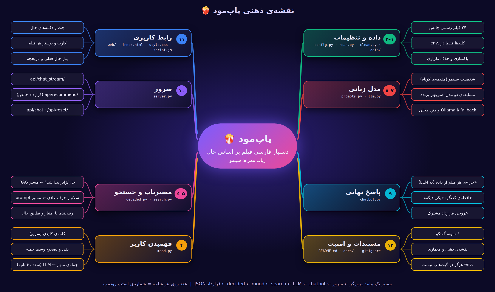

# 🍿 پاپ‌مود (PopMood)

> **«حالت رو بگو، فیلمش رو پاپ کن!»**
> دستیار فارسی پیشنهاد فیلم بر اساس حال کاربر — چالش آیولرن، بخش «هوش ۵» (دستیار سینما).
> پاپ‌مود نام محصول است و **سینمو** نام ربات همراه آن.



## ✨ پاپ‌مود چه کار می‌کند؟

کاربر به فارسی می‌نویسد چه حسی دارد («امروز غمگینم»، «عصبانیم ولی اکشن نمی‌خوام»). سینمو:

1. **حال و ژانر** را تشخیص می‌دهد (۵ حال قرارداد: `happy`، `sad`، `angry`، `surprise`، `neutral`)؛
2. **فقط از ۲۴ فیلم لیست رسمی چالش** فیلم پیشنهاد می‌دهد (RAG)؛
3. برای هر فیلم می‌گوید **«چرا»**؛
4. خروجی را در قالب **قرارداد مشترک** هم می‌دهد: `{"mood": "sad", "movies": [7, 11, 17]}`.

### ویژگی‌ها

| ویژگی | توضیح |
|---|---|
| تشخیص حال | کلمه‌ی کلیدی (سریع) و فقط برای جمله‌های مبهم، طبقه‌بند LLM با سقف ۶ ثانیه |
| نفی و اصلاح | «اکشن نباشه»، «غمگین نباشه»، «غم‌گین نباشه و درام هم نباشه»، «نه ناراحتم نه خوشحال» |
| تصحیح وسط جمله | «خوشحالم، نه صبر کن، الان عصبانیم» ← فقط بعد از تصحیح حساب می‌شود |
| حافظه‌ی گفتگو | «اکشن هم نباشه» قیدهای قبلی را نگه می‌دارد؛ «یکی دیگه» فیلم‌های جدید با همان قیدها می‌دهد |
| «چرا» بدون توهم | دلیل هر فیلم فقط از فیلدهای دیتاست ساخته می‌شود (برچسب حال، ژانر، امتیاز)، نه از LLM |
| شخصیت | سینمو: گرم، کوتاه‌گو، فقط درباره‌ی فیلم؛ سیاست و موضوع بی‌ربط را مؤدبانه رد می‌کند |
| پایداری | زنجیره‌ی مدل‌ها: gapgpt (چند مدل) ← Ollama محلی ← متن محلی؛ اگر اینترنت قطع شود هم برنامه خراب نمی‌شود |
| سرعت | مسابقه‌ی دو مدل اول (سریع‌تر برنده است)، گرم‌کردن اتصال‌ها و سقف زمانی برای تشخیص حال |
| رابط کاربری | تیره و سینمایی، دکمه‌های حال، پوستر هر فیلم، پنل «حال فعلی» و تاریخچه‌ی حال، JSON قرارداد |
| امنیت | کلید API فقط در `.env` (داخل `.gitignore`) |

## 🧠 معماری

```
پیام کاربر
    │
    ▼
decided.py ── حال/ژانر پیدا شد؟ ──► مسیر RAG
    │                                  mood.py   → تشخیص حال، نفی، تصحیح
    │                                  search.py → فیلتر قیدها + رتبه‌بندی
    │                                  LLM       → فقط مقدمه‌ی کوتاه و گرم
    │                                  chatbot.py→ فهرست فیلم‌ها و «چرا» (از داده)
    │
    └── سلام / حرف عادی / خارج از موضوع ──► مسیر prompt
                                       prompts.py + llm.py (فقط شخصیت سینمو)
```

**چرا بدون embedding؟** دیتاست رسمی فقط ۲۴ فیلم دارد و هر فیلم برچسب حال و ژانر دقیق. جستجوی مبتنی بر برچسب‌ها دقیق، قابل توضیح و سریع است و embedding هزینه و عدم‌قطعیت اضافه می‌کرد. (جعبه‌های chunking و embedding وایت‌بورد اولیه عمداً کنار گذاشته شدند.)

## 🗂 رودمپ و ساختار فایل‌ها

پروژه در **۱۲ استپ** ساخته شده و هر استپ دقیقاً یک فایل (یا پوشه) است:

```
popmood/
├── .env.example        ← استپ ۱: نمونه‌ی تنظیمات (کلید واقعی فقط در .env، که در گیت‌هاب نیست)
├── .gitignore
├── config.py           ← استپ ۱: خواندن .env و تنظیمات
├── read.py             ← استپ ۲: خواندن دیتاست
├── clean.py            ← استپ ۳: پاکسازی و ساخت متن فیلم
├── mood.py             ← استپ ۴: فهمیدن حال و ژانر کاربر
├── search.py           ← استپ ۵: جستجو و رتبه‌بندی فیلم‌ها
├── decided.py          ← استپ ۶: مسیریاب RAG / prompt
├── prompts.py          ← استپ ۷: شخصیت سینمو (system prompt)
├── llm.py              ← استپ ۸: مدل‌ها، fallback، مسابقه
├── chatbot.py          ← استپ ۹: مغز اصلی و خروجی قرارداد
├── server.py           ← استپ ۱۰: سرور Flask و API
├── web/                ← استپ ۱۱: سایت (index.html، style.css، script.js، تصاویر)
├── README.md           ← استپ ۱۲: مستندات
├── data/movies_sample.json   ۲۴ فیلم رسمی چالش
├── docs/               نقشه‌ی ذهنی و نمونه گفتگوها
└── requirements.txt
```

| استپ | فایل | برای چه ساخته شده | از چه فایل‌هایی استفاده می‌کند | چه کسی از آن استفاده می‌کند |
|---|---|---|---|---|
| ۱ | `config.py` | خواندن `.env` (کلیدها، لیست مدل‌ها، سوییچ‌ها) | `.env` | `read`، `clean`، `llm` |
| ۲ | `read.py` | بارگذاری ۲۴ فیلم و وصل‌کردن پوسترها بدون دست‌زدن به فایل رسمی | `config`، `data/` | `clean`، `search`، `chatbot` |
| ۳ | `clean.py` | حذف تکراری‌ها، ساخت متن فیلم، مبدل اختیاری TMDB | `read`، `config` | `search`، `chatbot` |
| ۴ | `mood.py` | تشخیص حال/ژانر، نفی، تصحیح؛ برای جمله‌های مبهم از LLM کمک می‌گیرد | `llm` (فقط در جمله‌های مبهم) | `decided`، `search` |
| ۵ | `search.py` | فیلتر قیدها و رتبه‌بندی با امتیاز، تخصصی‌بودن حال و ژانر | `read`، `clean`، `mood` | `chatbot` |
| ۶ | `decided.py` | تصمیم می‌گیرد پیام به مسیر RAG برود یا prompt؛ اصلاح‌ها را با قیدهای قبلی ادغام می‌کند | `mood` | `chatbot` |
| ۷ | `prompts.py` | شخصیت سینمو و ساخت پیام‌های LLM | — | `chatbot` |
| ۸ | `llm.py` | زنجیره‌ی مدل‌ها، مسابقه‌ی دو مدل، استریم، گرم‌کردن اتصال | `config` | `mood`، `chatbot`، `server` |
| ۹ | `chatbot.py` | کل پایپ‌لاین، «چرا»ی قطعی، حافظه، خروجی قرارداد | `read`، `clean`، `decided`، `search`، `prompts`، `llm` | `server` |
| ۱۰ | `server.py` | سرویس‌دهی سایت و API | `chatbot`، `llm` | مرورگر |
| ۱۱ | `web/` | چت، پوستر و کارت فیلم‌ها، پنل حال فعلی | API سرور | کاربر |
| ۱۲ | `README.md` | مستندات، نمونه گفتگوها، نقشه‌ی ذهنی | — | داور و کاربر |

## 🔌 قرارداد مشترک و API

خروجی استاندارد چالش (حال یکی از ۵ مقدار مجاز و شناسه‌ها فقط از `movies_sample.json`):

```json
{"mood": "sad", "movies": [7, 11, 17]}
```

| مسیر | کار |
|---|---|
| `GET /` | صفحه‌ی سایت |
| `POST /api/chat` | پاسخ کامل: متن، کارت‌ها (همراه «چرا»)، JSON قرارداد |
| `POST /api/chat_stream` | همان پاسخ به‌صورت NDJSON (رویدادهای `meta`، `delta`، `done`) |
| `POST /api/recommend` | **فقط JSON قرارداد**، برای بخش‌های دیگر چالش: `{"message": "امروز غمگینم"}` |
| `POST /api/reset` | پاک‌کردن حافظه‌ی گفتگو |

## 🚀 نصب و اجرا (ویندوز)

```bash
git clone https://github.com/M-HGordan/popmood.git
cd popmood
python -m venv .venv
.venv\Scripts\activate
pip install -r requirements.txt

copy .env.example .env      # سپس کلید gapgpt را داخل .env بگذارید
python server.py            # مرورگر روی http://127.0.0.1:5000 باز می‌شود
```

**تنظیمات `.env`:**

| متغیر | معنی |
|---|---|
| `GAPGPT_API_KEY`، `GAPGPT_BASE_URL` | کلید و آدرس سرویس سازگار با OpenAI |
| `GAPGPT_MODEL` | چند مدل با کاما؛ دو مدل اول مسابقه می‌دهند، بقیه fallback‌اند |
| `OLLAMA_MODEL`، `OLLAMA_URL` | مدل محلی اختیاری (آخرین fallback) |
| `GAPGPT_RACE` | `1` مسابقه‌ی دو مدل (پیش‌فرض)، `0` خاموش |
| `GAPGPT_STREAM` | `1` نمایش کلمه‌به‌کلمه، `0` خاموش (پیش‌فرض؛ با gapgpt سریع‌تر است) |
| `USE_TMDB` | `0` فقط لیست رسمی (پیش‌فرض)؛ `1` فیلم‌های اضافه‌ی TMDB |

بدون کلید یا بدون اینترنت هم برنامه اجرا می‌شود؛ مقدمه‌ی LLM با متن محلی جایگزین می‌شود و فهرست فیلم‌ها و «چرا» همچنان درست است.

## 💬 نمونه گفتگوها

خروجی واقعی با LLM؛ متن کامل در [`docs/samples.md`](docs/samples.md).

**۱) حال غمگین و «یکی دیگه»**
> کاربر: سلام ← سینمو: حال کاربر را می‌پرسد. | کاربر: امروز غمگینم
> پیشنهاد: در جستجوی خوشبختی، رستگاری در شاوشنک، فارست گامپ — `{"mood": "sad", "movies": [7, 11, 17]}`
> کاربر: یکی دیگه ← دست‌نیافتنی‌ها، شیرشاه، کوکو — `{"mood": "sad", "movies": [2, 23, 8]}`

**۲) هدف: بهترشدن حال**
> کاربر: یه فیلم بده حالم رو خوب کنه ← موش سرآشپز، فارست گامپ، شیرشاه — `{"mood": "happy", "movies": [19, 17, 23]}`

**۳) حال + ژانر**
> کاربر: عصبانی‌ام و اکشن می‌خوام ← مکس دیوانه: جاده خشم، جان ویک، زوتوپیا — `{"mood": "angry", "movies": [10, 22, 16]}`

**۴) درخواست بر اساس حس سینمایی**
> کاربر: دنبال یه فیلم پرپیچ‌وخم و ذهن‌درگیرکننده‌ام ← تلقین، انگل، نمایش ترومن — `{"mood": "surprise", "movies": [6, 24, 15]}`

**۵) نفی و اصلاح پشت‌سرهم (حافظه‌ی گفتگو)**
> کاربر: یه فیلم بده حالم خوب کنه و غمگین نباشه ← موش سرآشپز، هتل بزرگ بوداپست، زوتوپیا — `{"mood": "happy", "movies": [19, 4, 16]}`
> کاربر: اکشن هم نباشه ← همان فیلم‌ها، با «غمگین، اکشن نیست» در دلیل — قید قبلی از دست نمی‌رود
> کاربر: یکی دیگه ← مریخی — `{"mood": "happy", "movies": [18]}` (با ۳ قید فقط یک فیلم باقی مانده است)

**۶) حرف خارج از موضوع**
> کاربر: یه انیمیشن خانوادگی پیشنهاد بده ← شهر اشباح، شیرشاه، کوکو
> کاربر: درباره‌ی سیاست حرف بزنیم ← سینمو مؤدبانه رد می‌کند و حال را می‌پرسد — `{"mood": "neutral", "movies": []}`

## 🎨 پوستر فیلم‌ها و تصاویر

- دیتاست رسمی فیلد `poster` را خالی دارد. برای نمایش پوستر، عکس هر فیلم را با نام **شماره‌ی فیلم** در `web/posters/` بگذارید (مثلاً `5.jpg` برای Interstellar). سایت خودش آن‌ها را پیدا می‌کند و فایل رسمی دیتاست تغییر نمی‌کند. اگر پوستری نباشد، کارت با گرادیان رنگی هم‌حال فیلم نمایش داده می‌شود.
- پوسترها در `.gitignore` هستند و حقوق آن‌ها متعلق به صاحبان اصلی است.
- تصویر ربات سینمو و پس‌زمینه‌ی غروب با ابزار هوش مصنوعی تولید شده‌اند.

## ⚠️ محدودیت‌ها

- فقط ۲۴ فیلم دیتاست رسمی؛ با چند قید پشت‌سرهم ممکن است «یکی دیگه» فیلم کمتری برگرداند یا لیست خالی شود.
- نفی حال («غمگین نباشه») بر پایه‌ی برچسب `moods` دیتاست انجام می‌شود، نه تحلیل واقعی داستان فیلم.
- تشخیص حال برای جمله‌های خیلی غیرمعمول به LLM وابسته است و ممکن است `neutral` شود.
- مقدمه‌ی کوتاه را LLM می‌نویسد و گاهی تعبیرش کامل با برچسب فیلم‌ها جور نیست؛ فهرست فیلم‌ها و دلیل‌ها همیشه از داده ساخته می‌شوند.
- ماژول اختیاری TMDB حال فیلم‌ها را از روی ژانر حدس می‌زند (دیتاست TMDB فیلد حال ندارد) و پیش‌فرض خاموش است.
- تاریخچه‌ی حال در پنل کناری فقط تا رفرش صفحه می‌ماند.

## 🔒 امنیت

کلید API هرگز در مخزن قرار نمی‌گیرد: `.env` در `.gitignore` است و فقط `.env.example` (بدون کلید) منتشر می‌شود.

## 📚 منابع

دیتاست رسمی چالش آیولرن (`movies_sample.json`)، API سازگار با OpenAI (gapgpt)، Flask، فونت و ایموجی‌های سیستم. ماژول اختیاری TMDB: «This product uses the TMDB API but is not endorsed or certified by TMDB».
